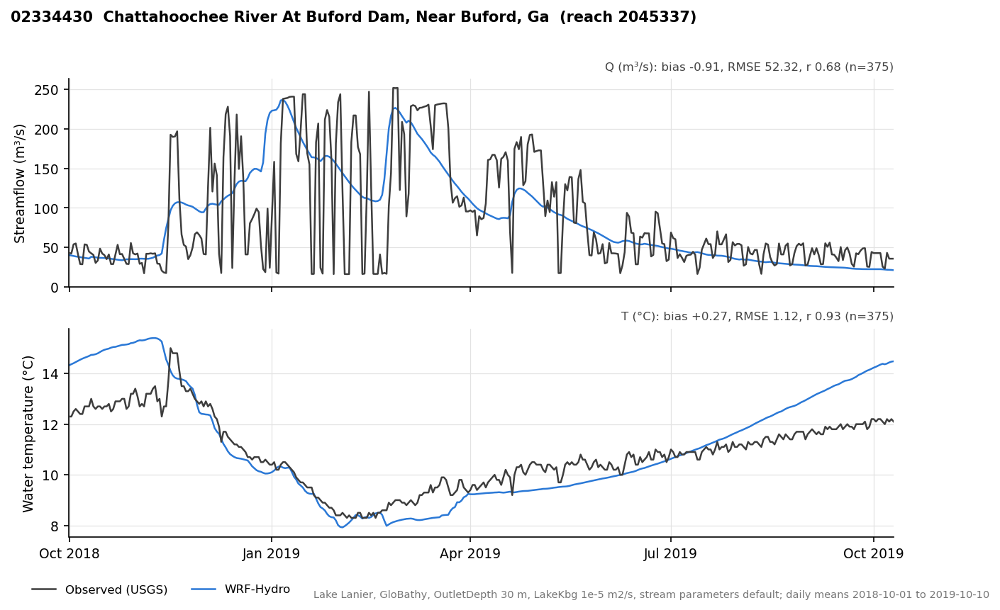
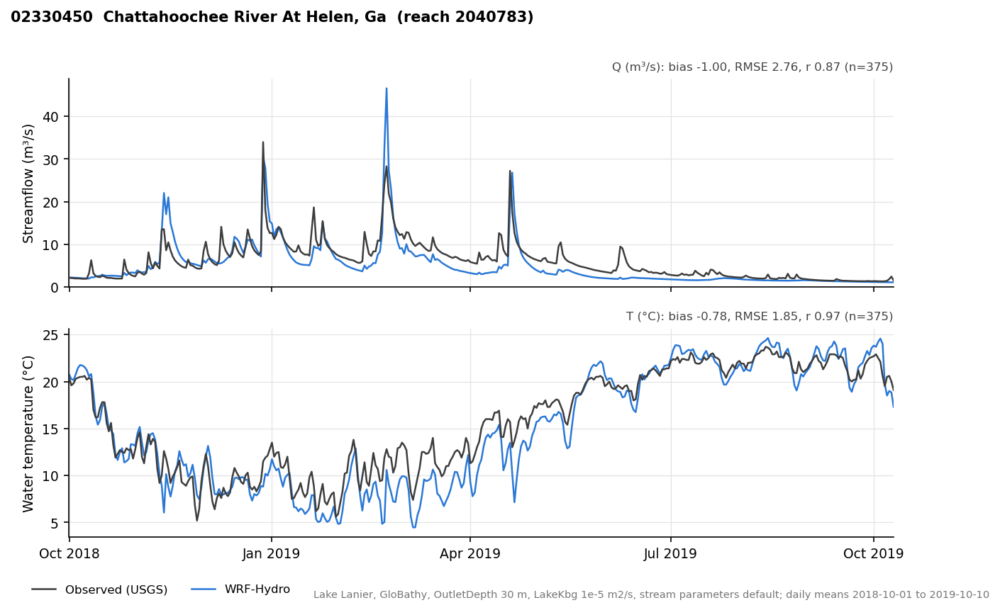

.. _water-temperature:

Stream and Lake Water Temperature
=================================

.. contents:: Contents
   :local:
   :depth: 2

Overview
--------

WRF-Hydro can simulate the water temperature of every reach in a reach-based
(UDMP) channel network and of the lakes and reservoirs on it. Three model
components are coupled:

#. **Stream temperature**: an equilibrium (WEAP-style) model. Water entering
   a reach is mixed by volume and then relaxes toward a local equilibrium
   temperature set by air temperature and solar radiation, over the time the
   water spends in the reach.
#. **Source-water temperatures**: surface runoff enters at the temperature
   computed by Noah-MP, and groundwater (bucket) outflow at a bucket water
   temperature that is tracked through time.
#. **Lake and reservoir temperature**: the 1-D multi-layer lake model in
   Noah-MP (``module_sf_lake``) runs on the lake grid cells. Rivers carry heat
   into each lake, and the lake's outflow enters the downstream river at the
   temperature of the lake at its outlet (withdrawal) depth.

The capability is switched on with ``water_temperature = 2`` in
``hydro.namelist``. With ``water_temperature = 0`` (the default), the model
behaves as before. Results for streamflow, the land surface and lakes do not
depend on whether temperature output is requested.

Data flow::

   forcing (T2, SWDOWN) --catchment mean--> reach air temperature, shortwave
                                              |
   Noah-MP runoff temp. (infxsrt_t) ----------+--> lateral inflow temperature --+
   Noah-MP drainage temp. --> GW bucket temperature --> baseflow temperature -----+
                                                                                  v
   upstream reaches (Q, T) -----------------------------> volume-weighted mixing (T_in)
                                                                                  |
                                       relaxation toward T_e over the travel time v
                                                                                  |
                                                         reach temperature (riverTemp)
                                                                                  |
   lake pour points <-- 1-D lake temperature at OutletDepth <-- inflow heat ------+

Requirements and configuration
------------------------------

Supported configuration
~~~~~~~~~~~~~~~~~~~~~~~

- Reach-based routing with the user-defined mapping: ``UDMP_OPT = 1``. The
  model stops with an error if ``water_temperature = 2`` is used without
  ``UDMP_OPT = 1``. It has been tested with Muskingum-Cunge routing
  (``channel_option = 2``).
- Noah-MP land model (HRLDAS driver).
- For lakes and reservoirs: level-pool reservoirs (``route_lake_f``) and the
  1-D lake model (``SF_LAKE_PHYSICS = 1``).
- Groundwater: the reach-based bucket model (``GWBASESWCRT = 1`` with
  ``GWBUCKPARM``) for tracked groundwater temperatures.

``water_temperature = 1`` (an earlier gridded-channel temperature model) has
been removed; setting it stops the model with a message pointing to the
archived code (git tag ``archive/gridded-water-temperature``).

hydro.namelist
~~~~~~~~~~~~~~

.. code-block:: fortran

   &HYDRO_nlist
    UDMP_OPT          = 1
    channel_option    = 2
    route_link_f      = "./DOMAIN/Route_Link.nc"     ! may hold the optional stream parameters
    route_lake_f      = "./DOMAIN/LAKEPARM.nc"       ! may hold the optional lake parameters
    GWBUCKPARM_file   = "./DOMAIN/GWBUCKPARM.nc"     ! may hold the optional Dtherm
    water_temperature = 2       ! 0 = off (default), 2 = equilibrium stream + lake temperature
    CHRTOUT_DOMAIN    = 1       ! riverTemp and the T_* diagnostics
    output_gw         = 1       ! optional: GWOUT with T_bucket
    outlake           = 1       ! optional: LAKEOUT with T_inflow, T_outflow
   /

namelist.hrldas (lakes)
~~~~~~~~~~~~~~~~~~~~~~~

.. code-block:: fortran

   &NOAHLSM_OFFLINE
    HRLDAS_SETUP_FILE = "./DOMAIN/wrfinput.nc"   ! must contain LAKE_ID (and LAKE_DEPTH)
    SF_LAKE_PHYSICS   = 1        ! run the 1-D lake model on lake cells
    USE_LAKEDEPTH     = 1        ! use LAKE_DEPTH from the setup file
    LAKEDEPTH_DEFAULT = 24       ! [m] depth where LAKE_DEPTH is missing
    LAKE_MIN_ELEV     = 5.0      ! [m] cells below this elevation are not lakes
   /

Input requirements for lakes
~~~~~~~~~~~~~~~~~~~~~~~~~~~~

- The HRLDAS setup file (wrfinput) holds ``LAKE_ID`` (the ``lake_id`` of
  LAKEPARM on each lake cell) and ``LAKE_DEPTH`` (m). Every cell with
  ``LAKE_ID > 0`` must have the lake land-use class (``IVGTYP = ISLAKE``); the
  model stops at initialization if it finds a mismatch. Making the two
  consistent is a pre-processing step.
- Lake depth matters a lot for reservoirs with deep withdrawals. A column that
  is too shallow warms through its whole depth in summer, so there is no cold
  water to release. Use bathymetry where available (e.g. GloBathy), and check
  that the deepest cells are close to the reservoir's real depth near the dam.
  Coarse grids can average the narrow, deep channel of a valley reservoir with
  its shallow margins.

Stream temperature model
------------------------

Source: ``src/Routing/RiverTemperature/module_stream_temperature_eq.F``. The
model runs once per land-surface time step (``DT`` in hydro.namelist) after
channel routing, on every reach.

Inflow mixing
~~~~~~~~~~~~~

The temperature of the water entering reach *i* is the volume-weighted mean of
its upstream reaches, its surface lateral inflow and its groundwater inflow:

.. math::

   T_{in} = \frac{\sum_j Q_j T_j + Q_{sfc} T_{sfc} + Q_{gw} T_{gw}}
                 {\sum_j Q_j + Q_{sfc} + Q_{gw}}

- :math:`Q_j, T_j`: outflow and temperature of the upstream reaches *j*. The
  upstream temperatures are those of the previous time step. This makes the
  result independent of the MPI decomposition (they are gathered with the same
  communication pattern as the flow routing), but it also means a temperature
  signal moves at most one reach per time step.
- :math:`Q_{gw}, T_{gw}`: bucket outflow to the reach and the bucket water
  temperature (see `Groundwater bucket temperature`_). Where no bucket
  temperature exists, a fallback of 12 °C is used.
- :math:`Q_{sfc}, T_{sfc}`: the rest of the lateral inflow (``q_lateral``
  minus the bucket outflow). Its temperature is the Noah-MP surface runoff
  temperature (``infxsrt_t``: 0 °C under snow, otherwise the ground surface
  temperature) at the grid cells whose runoff enters the reach, weighted by the
  water each cell delivers. Where that is not available, the instantaneous reach
  air temperature is used.

A reach with no inflow (dry headwater) is set to its equilibrium temperature.

Equilibrium temperature
~~~~~~~~~~~~~~~~~~~~~~~

.. math::

   T_e = \overline{T}_{air} + \frac{SW_{net}}{K_{sw}}, \qquad
   SW_{net} = SW_{in}\,(1 - \alpha)\,(1 - f_{shade})

- :math:`\overline{T}_{air}`: the reach air temperature smoothed with an
  exponential moving average, :math:`\overline{T}_{air} \leftarrow a\,T_{air} +
  (1-a)\,\overline{T}_{air}`, :math:`a = \min(1, DT/\tau)`, with e-folding time
  :math:`\tau` = ``TauTair``. Without smoothing, the simulated daily range of
  water temperature was several times larger than observed (13–15 °C in the
  first DRB tests); the smoothing stands in for the thermal inertia of the water
  column and the streambed.
- :math:`SW_{in}`: downward shortwave radiation; :math:`\alpha` the water
  surface albedo (``Albedo``), :math:`f_{shade}` the riparian shading fraction
  (``Shade``).
- :math:`K_{sw}`: shortwave equilibrium coefficient (``Ksw``), W m\ :sup:`-2`
  °C\ :sup:`-1`. Only the combination :math:`(1-\alpha)/K_{sw}` matters, so
  ``Albedo`` and ``Ksw`` cannot be tuned independently.

Reach air temperature and shortwave are the area-weighted means over each
reach's catchment, using the UDMP spatial weights (the same mapping that
aggregates land runoff to reaches).

Relaxation along the reach
~~~~~~~~~~~~~~~~~~~~~~~~~~

.. math::

   T_{out} = T_e + (T_{in} - T_e)\,\exp\!\left(-\frac{K_{exch}}{\rho c_p h}\,\frac{L}{v}\right)

with :math:`K_{exch}` the bulk surface heat exchange coefficient (``Kexch``,
W m\ :sup:`-2` °C\ :sup:`-1`), :math:`h` the routed water depth (``HLINK``),
:math:`L` the reach length and :math:`v` the routed velocity. For a reach
deeper than 2 cm with positive velocity; otherwise :math:`T_{out} = T_{in}`.

Because :math:`v\,h \approx Q/W` for a channel of width *W*, the exponent is
approximately :math:`K_{exch} L W / (\rho c_p Q)`. The warming or cooling
over a reach in daily means depends on the water-surface area per unit flow,
not on the velocity. Velocity mainly sets the timing.

Bounds: water temperature is limited to 0–40 °C, and air temperature to
−15–40 °C. There is no river-ice model: water is held at 0 °C when the
equilibrium or the inflows would be colder.

Lake pour points
~~~~~~~~~~~~~~~~

Reaches that receive a lake's outflow (``TYPEL = 1``) take the lake outflow
temperature (see `Outflow temperature`_) instead of the relaxation
above, and pass it downstream. Until the lake has a valid temperature the
reach uses its equilibrium temperature.

Groundwater bucket temperature
------------------------------

Source: ``simp_gw_buck_nhd`` in ``src/Routing/module_GW_baseflow.F``
(UDMP buckets).

Each bucket is treated as well mixed. Drainage from the bottom of the Noah-MP
soil column enters at the temperature of the bottom soil layer and mixes with
the stored water by volume. Bucket outflow leaves at the bucket temperature.
An optional thermal damping depth :math:`D_{therm}` (m of water equivalent)
represents the heat capacity of the aquifer material:

.. math::

   T_{b}^{new} = \frac{(z + D_{therm})\,T_b + \Delta z\,T_{in}}{z + D_{therm} + \Delta z}

with :math:`z` the bucket storage and :math:`\Delta z` the recharge in the time
step. :math:`D_{therm} = 0` (the default) is a pure well-mixed bucket.
Larger values damp and delay the seasonal cycle of the baseflow
temperature. ``Dtherm`` changes only the temperature, not the bucket water
balance.

On a cold start (or a restart file without bucket temperatures), each bucket is
seeded with the soil temperature of its catchment. Damped buckets respond
slowly, so they need a spin-up or a seed close to their long-term mean.

Lake and reservoir temperature
------------------------------

The 1-D lake model
~~~~~~~~~~~~~~~~~~

Source: ``src/Land_models/NoahMP/phys/module_sf_lake.F`` (the CLM-based lake
scheme from WRF), called from the HRLDAS driver
(``module_NoahMP_hrldas_driver.F``). Each lake grid cell is a column of 10
water layers (plus snow and sediment layers). The model computes surface energy
fluxes, ice, snow and the vertical temperature profile with eddy and convective
mixing.

Coupling with the level-pool reservoirs (all with ``SF_LAKE_PHYSICS = 1``,
independent of ``water_temperature``):

- **Water balance**: the level-pool reservoir carries the lake water balance
  (inflow − outflow + precipitation − evaporation). Precipitation and
  evaporation over the lake come from the 1-D lake model, averaged over each
  lake's cells (and summed across MPI ranks).
- **Lake depth**: the 1-D model's lake depth follows the change of the
  level-pool water elevation. The reference elevation is kept in the hydro
  restart file, so restarts reproduce continuous runs. The layer structure
  itself is set at initialization and does not change.
- **Sub-stepping**: the lake model runs with sub-steps of at most 600 s within
  each land-surface step. This removed a numerical instability of the lake
  snow scheme in rain-on-snow events at hourly steps.

River inflow heat
~~~~~~~~~~~~~~~~~

With ``water_temperature = 2``, each lake receives the heat carried by its
inflowing rivers. Over one step the lake receives
:math:`V = Q_{in}\,\Delta t` of water at the flow-weighted inflow temperature
:math:`T_{in}`, spread over the lake area (LAKEPARM ``LkArea``) as a layer of
thickness :math:`h = V/A` in every column:

- The inflow enters at its level of neutral buoyancy: the first ice-free layer
  whose density is at least that of the inflow (the bottom layer if none is).
- An equal volume leaves through the outlet, so the water between the
  insertion layer and the outlet layer is displaced by *h* toward the outlet
  (first-order upwind). The heat change of a column is :math:`h\,(T_{in} -
  T_{outlet})`.
- If *h* exceeds the ice-free column depth, the column is flushed to
  :math:`T_{in}`.

There is no entrainment of lake water into the inflow, so cold inflows reach
their neutral-buoyancy level undiluted.

Outflow temperature
~~~~~~~~~~~~~~~~~~~

The lake outflow temperature is the lake temperature at the outlet
(withdrawal) depth ``OutletDepth``, measured below the top of the lake column
(normal full pool):

- In each lake cell, the profile is interpolated linearly at the outlet depth.
- The values are averaged over the lake cells whose column reaches the
  outlet depth. If no cell is that deep, all cells are averaged, each
  taken at its bottom layer. This keeps shallow arms and coves from
  contributing their warm bottom water to a deep withdrawal.
- ``OutletDepth = 0`` is a surface withdrawal.

Without an ``OutletDepth`` in LAKEPARM, the outlet depth is
``WeirE − OrificeE`` (the orifice depth below the weir crest).

Vertical mixing parameters
~~~~~~~~~~~~~~~~~~~~~~~~~~

The lake model's eddy diffusivity is :math:`k = k_m + k_e + K_{bg}`:

- :math:`k_m` = 1.4×10\ :sup:`-7` m\ :sup:`2` s\ :sup:`-1` (molecular).
- :math:`k_e`: wind-driven (Hostetler) diffusivity. It decays with depth as
  :math:`\exp(-k_s z)` and is damped by stratification. In columns deeper
  than 15 m, it is multiplied by ``LakeMixFact`` (default 100) when the surface
  is warmer than 4.15 °C, and by 10\ :sup:`4` (10\ :sup:`5` deeper than
  150 m) when colder.
- :math:`K_{bg}` (``LakeKbg``): background diffusivity at every layer, default
  0. Below the thermocline :math:`k_e` is negligible, so without
  :math:`K_{bg}` the deep water of a stratified reservoir mixes only
  molecularly and hardly warms during the summer. Hypolimnetic diffusivities
  in reservoirs are typically 10\ :sup:`-6`–10\ :sup:`-5` m\ :sup:`2`
  s\ :sup:`-1`.

``LakeMixFact`` affects mainly the upper 5–10 m. ``LakeKbg`` controls the
warming of the deep water and therefore the release temperature of deep
withdrawals.

Parameters
----------

All temperature parameters are optional variables in the existing parameter
files. A variable that is absent uses the default; invalid values are replaced
by the default and counted in the log. Parameters are not set in the namelist.

Route_Link (per reach, dimension ``feature_id``)
~~~~~~~~~~~~~~~~~~~~~~~~~~~~~~~~~~~~~~~~~~~~~~~~~

========== ================================================= ============= ===================
Variable   Meaning                                           Units         Default (valid)
========== ================================================= ============= ===================
Kexch      bulk surface heat exchange coefficient            W m-2 °C-1    50 (> 0)
Ksw        shortwave equilibrium coefficient                 W m-2 °C-1    400 (> 0)
TauTair    e-folding time of the air-temperature smoothing   s             86400 (> 0)
Shade      fraction of shortwave blocked by riparian shading 1             0 (0–1)
Albedo     water surface albedo                              1             0 (0–1)
========== ================================================= ============= ===================

GWBUCKPARM (per bucket, dimension ``BasinDim``)
~~~~~~~~~~~~~~~~~~~~~~~~~~~~~~~~~~~~~~~~~~~~~~~~

========== ================================================= ============= ===================
Variable   Meaning                                           Units         Default (valid)
========== ================================================= ============= ===================
Dtherm     bucket thermal damping depth (water equivalent)   m             0 (≥ 0)
========== ================================================= ============= ===================

LAKEPARM (per lake, dimension ``feature_id``)
~~~~~~~~~~~~~~~~~~~~~~~~~~~~~~~~~~~~~~~~~~~~~~

=========== ================================================ ============= ======================
Variable    Meaning                                          Units         Default (valid)
=========== ================================================ ============= ======================
OutletDepth outlet (withdrawal) depth below full pool        m             WeirE − OrificeE (≥ 0)
LakeMixFact wind-driven diffusivity enhancement, deep lakes  1             100 (> 0)
            (> 15 m) with a warm surface
LakeKbg     background eddy diffusivity at all layers        m2 s-1        0 (≥ 0)
=========== ================================================ ============= ======================

Each variable must have one value per lake (or reach, or bucket). A scalar
variable is ignored with a warning, and the default is used. With NCO, write
lake parameters as an array, for example::

   ncap2 -O -s 'LakeKbg=OrificeE*0.0+1e-5' LAKEPARM.nc LAKEPARM_new.nc

(``ncap2 -s LakeKbg=1e-5`` creates a scalar.) The script
``tests/local/water_temperature/add_temp_params.py`` writes the Route_Link and
GWBUCKPARM variables into copies of the files, as uniform values or as a test
pattern.

Values used in the test cases
~~~~~~~~~~~~~~~~~~~~~~~~~~~~~

====================== ========================== ================================
Parameter              Delaware River Basin       Lake Lanier
====================== ========================== ================================
Kexch, TauTair         100, 4 d                   50, 1 d (defaults)
Dtherm                 1 m                        0
OutletDepth            12.3 m (Cannonsville),     30 m (Buford Dam)
                       20 m (Pepacton)
LakeKbg                0                          1e-5 m2 s-1
Lake depths            uniform 24 m               GloBathy (3–43 m)
====================== ========================== ================================

These values come from short sensitivity runs and are not a general
calibration.

Compile-time constants
~~~~~~~~~~~~~~~~~~~~~~

In ``module_stream_temperature_eq.F``: the fallback groundwater temperature
(12 °C), the surface-runoff temperature option (``surf_temp_opt = 2``:
Noah-MP runoff temperature; 1: instantaneous air temperature), the
temperature bounds, the minimum depth (0.02 m) and the minimum flow
(10\ :sup:`-4` m\ :sup:`3` s\ :sup:`-1`). In the HRLDAS driver: the lake
sub-step (600 s).

Output
------

With ``water_temperature = 2`` the following variables are written (°C,
−9999 where not applicable):

=========== ================= ============================================================
File        Variable          Meaning
=========== ================= ============================================================
CHRTOUT     riverTemp         reach outflow temperature
CHRTOUT     T_eq              equilibrium temperature
CHRTOUT     T_airSmooth       smoothed reach air temperature
CHRTOUT     T_upstream        flow-weighted temperature of the upstream inflow
CHRTOUT     T_lateral         temperature of the surface (non-bucket) lateral inflow
CHRTOUT     T_gwInflow        temperature of the bucket inflow to the reach
GWOUT       T_bucket          bucket water temperature (needs ``output_gw = 1``)
LAKEOUT     T_inflow          flow-weighted temperature of the lake's inflow
LAKEOUT     T_outflow         lake outflow temperature (at OutletDepth)
=========== ================= ============================================================

The 1-D lake state is in LDASOUT when ``SF_LAKE_PHYSICS = 1``:
``LAKE_T3D`` (layer temperatures, K), ``LAKE_ICE3D``, ``LAKE_DEPTH2D``,
``LAKE_PRECIP2D`` and ``LAKE_EVAP2D`` (mm h\ :sup:`-1`).

Restarts
--------

The temperature state is saved in the restart files and read back, so a warm
restart reproduces a continuous run. The only exception is ``qstrmvolrt``, an
accumulated variable.

- ``HYDRO_RST``: ``T_air_smooth``, ``T_QSUM_prev`` (previous reach
  temperature), ``lake_inflow_temp``, ``lake_resht_lsm`` (lake depth
  reference elevation), ``infxsrt_t``, ``infxsrt_t_rt``, ``soldrain_t``,
  ``z_gwsubbas_t`` (bucket temperature).
- ``RESTART`` (HRLDAS): the lake columns (``LAKE_T_LAKE``,
  ``LAKE_ICEFRAC``, ``LAKE_Z_LAKE``, ``LAKE_DEPTH``, snow on lakes, ...).

Restart files written without these variables can still be read. Missing
temperature states are re-seeded (air-temperature smoothing from the current
forcing, buckets from soil temperature, and the lake from its initial profile
if the lake variables are missing).

Evaluation tools
----------------

Scripts in ``tests/local/water_temperature/``:

=============================== ==============================================================
Script                          Purpose
=============================== ==============================================================
eval_usgs_seasonal.py           Daily-mean bias, RMSE and r against USGS gauges, by season,
                                gauge group (above / below reservoirs) and site, plus daily
                                maximum, minimum and range. Options ``--huc8``, ``--lakes``.
temp_source_breakdown.py        Upstream flow-weighted groundwater, surface and source
                                temperatures, T_eq and air temperature for each gauge, by month
check_temp_outputs.py           Consistency of the T_* outputs; bit-comparison of two runs
add_temp_params.py              Write the Route_Link / GWBUCKPARM temperature parameters
check_lake_inflow_heat.py,      Checks of individual pieces (lake inflow heat, MPI rank
check_mpi_ranks.py, ...         independence, lake depth, lake P and E, reach forcing)
=============================== ==============================================================

Gauge observations (USGS daily mean, minimum and maximum water temperature,
parameter 00010, and discharge) are fetched from NWIS and mapped to reaches
with the NLDI service.

Test cases and performance
--------------------------

Daily means, 1 October 2018 – 10 October 2019, after a one-year spin-up:

============================== ========================= =========== ==========
Domain, gauges                 Group                     Bias (°C)   RMSE (°C)
============================== ========================= =========== ==========
Delaware River Basin           above reservoirs          −0.55       1.46
(HUC8 02040101, 02040102)      below reservoirs          −0.42       2.06
Lake Lanier                    above reservoir (5)       +0.22       1.84
(HUC8 03130001)                below Buford Dam (5)      +0.19       1.55
============================== ========================= =========== ==========

   Lake Lanier test case: streamflow and water temperature of the Buford Dam
   release (USGS 02334430), October 2018 – October 2019. The release
   temperature follows the reservoir's hypolimnion (30 m withdrawal,
   ``LakeKbg`` = 10\ :sup:`-5` m\ :sup:`2` s\ :sup:`-1`). The modeled
   release flow is the level-pool outflow, not the dam's daily operations.

   Lake Lanier test case: Chattahoochee River at Helen, GA (USGS 02330450),
   an unregulated headwater gauge.

The Lake Lanier case, with its namelists, domain files, observations and
reference results, is packaged for testing (see the project's test-case
directory).

Limitations
-----------

- No river ice. Winter temperatures are limited to 0 °C; the model is designed
  for warm-season and low-flow conditions.
- The simulated daily temperature range is about half of the observed range
  (the smoothed air temperature removes part of the diurnal forcing). The model
  is aimed at daily means and seasonal patterns.
- Upstream temperatures lag one time step per reach, so a temperature signal
  travels one reach per time step regardless of flow velocity.
- Spring water temperatures at unregulated gauges are too cold in both test
  domains (about −1 to −1.5 °C); in the Delaware River Basin this was traced
  mainly to cold groundwater inflow.
- Reservoirs: releases follow the level-pool outflow, not dam operations. A
  constant ``LakeKbg`` gives a release that is too cold in spring and too warm
  in fall at Lake Lanier. The 1-D lake has no horizontal structure and no
  entrainment of inflows. The lake layer thicknesses are fixed at
  initialization.
- Lakes receive no direct lateral inflow in reach-based routing, only the
  inflow of their upstream reaches.
- Persistence and RFC-forecast reservoir types do not include lake
  precipitation and evaporation, and are not supported for water temperature.

References
----------

- Edinger, J. E., Brady, D. K., and Geyer, J. C. (1974). *Heat exchange and
  transport in the environment.* Report 14, Electric Power Research Institute.
- Stockholm Environment Institute. *WEAP Water Evaluation And Planning
  System: Technical Reference.*
- Dingman, S. L. (2002). *Physical Hydrology*, 2nd ed. Prentice Hall.
- Hostetler, S. W., and Bartlein, P. J. (1990). Simulation of lake evaporation
  with application to modeling lake level variations of Harney-Malheur Lake,
  Oregon. *Water Resources Research*, 26(10), 2603–2612.
- Subin, Z. M., Riley, W. J., and Mironov, D. (2012). An improved lake model
  for climate simulations. *Journal of Advances in Modeling Earth Systems*, 4,
  M02001.
- Gu, H., Jin, J., Wu, Y., Ek, M. B., and Subin, Z. M. (2015). Calibration and
  validation of lake surface temperature simulations with the coupled
  WRF-lake model. *Climatic Change*, 129, 471–483.
- Khazaei, B., et al. (2022). GLOBathy, the global lakes bathymetry dataset.
  *Scientific Data*, 9, 36.

Development history
-------------------

The equilibrium stream temperature model, the coupling of the 1-D lake model
to the channel network, the air-temperature smoothing and the outlet-depth
sampling were developed by David Yates (NCAR) for the Delaware River Basin
(2026). The capability was then extended and revised: catchment-mean reach
forcing; Noah-MP runoff temperatures; groundwater bucket temperature tracking;
per-reach, per-bucket and per-lake parameters; river inflow heat into lakes;
lake precipitation and evaporation coupling; lake sub-stepping; deep-cell
outflow sampling; lake mixing parameters; restart and MPI consistency; new
diagnostic output; and evaluation at two test domains.
